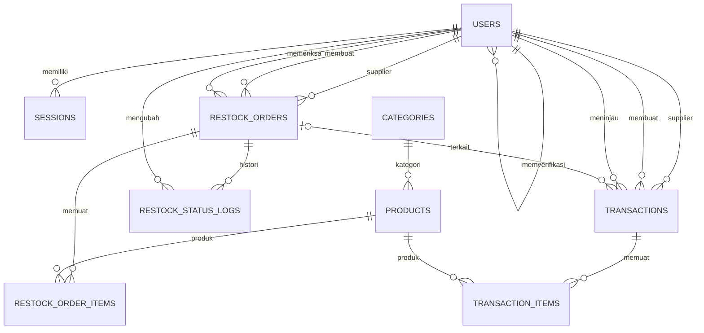

# ERD aktif FashStock

Gunakan hanya schema `fashstock_web` pada pgAdmin: Databases > fashstock > Schemas > fashstock_web. Generate ERD dari schema tersebut, bukan seluruh database. Supplier adalah baris `users` dengan role `supplier`, bukan tabel terpisah.

Tabel public lama tidak dihapus atau dipindahkan otomatis. Backup dan audit dependensi sebelum pembersihan. Untuk instalasi baru, jalankan hanya SETUP-FASHSTOCK.sql pada database kosong; fashstock.sql adalah salinan kompatibilitas, jangan jalankan keduanya. Database aktif tidak perlu di-reset.
